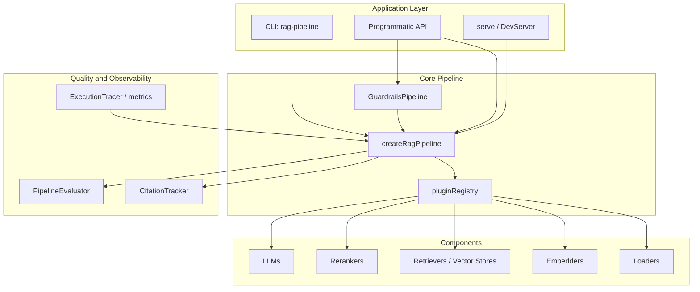
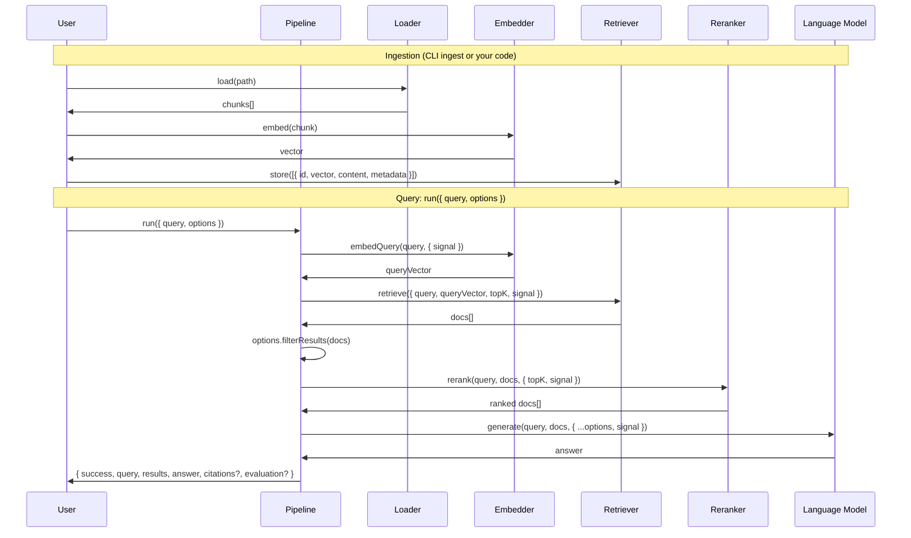

# Architecture

This guide outlines the internal architecture of @devilsdev/rag-pipeline-utils: the pipeline factory, the plugin contracts and registry, the guardrails, and how the CLI builds on them. Understanding it helps when you extend the system, write custom plugins or tune performance.

---

## Core Design Philosophy

### **SOLID Principles Implementation**

- **Single Responsibility Principle (SRP)**: Each component handles one specific domain concern

  - Loaders only handle document ingestion
  - Embedders only convert text to vectors
  - Retrievers only manage vector storage and search
  - LLMs only generate responses

- **Open/Closed Principle (OCP)**: System is open for extension but closed for modification

  - New plugins can be added without changing core code
  - Plugin contracts (`contracts/*.json`) define the required methods per stage
  - Cross-cutting behaviour wraps the pipeline (for example `GuardrailsPipeline`, `CostTracker.wrap()`, `ExecutionTracer.trace()`) instead of changing it

- **Liskov Substitution Principle (LSP)**: Any plugin can be replaced with another of the same type

  - An OpenAI embedder can be swapped for the Cohere or local TF-IDF embedder
  - Retrievers (`MemoryRetriever`, `FileVectorStore`, `HybridRetriever`, `GraphRetriever`, custom stores) are interchangeable as long as they implement `retrieve()`

- **Interface Segregation Principle (ISP)**: Plugins only implement the methods of their stage

  - Loaders don't depend on LLM interfaces
  - Embedders don't need retriever methods

- **Dependency Inversion Principle (DIP)**: The pipeline depends on stage contracts, not implementations
  - Components are passed in as instances or resolved by name from a registry
  - Configuration (`.ragrc.json`) drives which components the CLI builds
  - Easy testing with mock implementations

### **Additional Architectural Principles**

- **Plugin-Based Architecture**: Every stage is a replaceable component
- **Cancellable by design**: Every run has an `AbortSignal` that reaches every component call
- **Streaming support**: `run({ options: { stream: true } })` returns an async iterable of tokens
- **Configuration-Driven CLI**: `.ragrc.json` pipeline entries resolve to built-in components or custom plugin modules
- **Fail-Fast Validation**: Plugin contracts and configuration are validated early with detailed error messages
- **Results, not exceptions**: `run()` resolves `{ success: false, error }` on failure, timeout or abort

---

## System Architecture Overview

### **High-Level Component Diagram**



### **Data Flow Architecture**

The library pipeline (`createRagPipeline`) handles the query path. Ingestion is done by the CLI (`rag-pipeline ingest`) or by your own code calling the embedder and the retriever's `store()`.



---

## Plugin System

### **Plugin Registry**

`pluginRegistry` (exported singleton) maps a stage and a name to a component, so pipelines and `.ragrc.json` files can refer to plugins by name:

```javascript no-run
import {
  pluginRegistry,
  createRagPipeline,
} from "@devilsdev/rag-pipeline-utils";

const myEmbedder = {
  metadata: { name: "my-embedder", version: "1.0.0", type: "embedder" },
  async embed(text, { signal } = {}) {
    // return number[]
  },
};

await pluginRegistry.register("embedder", "my-embedder", myEmbedder);

const pipeline = createRagPipeline({
  embedder: "my-embedder", // resolved from pluginRegistry
  retriever,
  llm,
});
```

- `register(category, name, impl, manifest?, { content }?)` is asynchronous. Categories are `loader`, `embedder`, `retriever`, `llm` and `reranker`.
- The implementation must carry `metadata: { name, version, type }` (with `type` equal to the category) and the methods of the stage contract, otherwise registration throws.
- If a signed manifest is supplied, its Ed25519 signature (and `contentDigest`, if present) is verified before registration. Verification is on and fails closed when `NODE_ENV=production`; the trust store is empty by default. See the [Security guide](./Security.md#plugin-signature-verification).
- `get(category, name)` and `list(category)` look plugins up.

### **Plugin Contract System**

Each stage has a JSON contract under `contracts/` listing its required methods:

| Stage       | Required methods        | Called by the pipeline as                                                                                  |
| ----------- | ----------------------- | ---------------------------------------------------------------------------------------------------------- |
| `loader`    | `load()`                | `loader.load()` at the start of a run (if a loader is configured)                                          |
| `embedder`  | `embed()`               | `embedder.embedQuery(query, { signal })` if present, else `embedder.embed(query, { signal })`              |
| `retriever` | `store()`, `retrieve()` | `retriever.retrieve({ query, queryVector, topK, signal })`                                                 |
| `reranker`  | `rerank()`              | `reranker.rerank(query, docs, { topK, signal })`                                                           |
| `llm`       | `generate()`            | `llm.generate(query, docs, { ...options, signal })`; `generateStream()` is used for streaming when present |

Components that ignore `signal` still work: on abort the run settles anyway and no later stage starts.

### **Configuration-driven components (CLI)**

The CLI reads `.ragrc.json` pipeline entries `{ stage, name, config }`. A name resolves to a built-in component (for example `local`, `openai`, `ollama`, `cohere` embedders; `file-store` and `memory` retrievers; `openai`, `anthropic`, `ollama` LLMs; `scoring` reranker), to a custom module listed under `plugins`, or to a plugin registered on `pluginRegistry`. See the [CLI reference](./CLI.md).

---

## Pipeline Factory Pattern

`createRagPipeline({ loader, embedder, retriever, llm, reranker, registry })` returns `{ run, cleanup }`. Each component may be an instance or a name resolved from `registry` (default: the exported `pluginRegistry`).

`run({ query, queryVector, options })` performs, in order:

1. `loader.load()` if a loader is configured.
2. Query embedding with the embedder, unless `queryVector` is given.
3. `retriever.retrieve({ query, queryVector, topK, signal })` (`topK` defaults to 3).
4. `options.filterResults(docs)`, a hook that runs before anything downstream (including the LLM) sees the documents. `GuardrailsPipeline` uses it for the retrieval guard.
5. `reranker.rerank(query, docs, { topK, signal })` if a reranker is configured.
6. `llm.generate(query, docs, { ...options, signal })`. Without an llm the pipeline is retrieval-only and returns `answer: null`.
7. Citations (`options.citations`) and evaluation (`options.evaluate`, with `referenceAnswer` for context recall).

Run options also include `timeout` (ms, resolves `{ success: false, error: 'Execution timeout' }`), `signal` (caller cancellation, resolves `'Execution aborted'`) and `stream`. With `stream` plus `citations` or `evaluate`, the stream ends with one `{ token: '', done: true, citations, evaluation }` chunk.

---

## Cross-cutting Concerns

There is no middleware stack. Cross-cutting behaviour is added by wrapping the pipeline or the components:

- **Guardrails**: `GuardrailsPipeline` wraps any object with a `run()` method (see [Guardrails](#guardrails)).
- **Retries**: built-in connectors retry transient failures (network errors, 408/409/425/429/5xx) with exponential backoff, jitter and `Retry-After`. `retry` / `withRetry` are exported for your own components.
- **Cost**: `CostTracker` wraps a pipeline and records token usage and cost; `CostCalculator` exposes pricing provenance (`PRICING_METADATA`).
- **Tracing**: `ExecutionTracer` wraps a pipeline and records per-run traces; `TraceInspector` analyses them.
- **Caching**: `EmbeddingReranker` keeps an LRU cache of document embeddings (`cacheSize`).

---

## Event System & Observability

Several classes are `EventEmitter`s and report what they do: `PipelineEvaluator` emits `evaluated`, the guards emit `checked` / `filtered`, `GuardrailsPipeline` emits `preRetrieval`, and `DevServer` / `HotReloadManager` emit reload events. The `metrics` export provides `Counter`, `Histogram`, `Gauge`, `MetricsRegistry` and a `pipelineMetrics` instance; `eventLogger` provides `PipelineEventLogger`. `MetricsAggregator` and `DashboardGenerator` turn recorded metrics into a self-contained HTML dashboard. See [Observability](./Observability.md).

---

## Security Architecture

### **Plugins run in-process**

Plugins run in the same Node.js process with your permissions; there is no working sandbox (`PluginSandbox` is experimental and non-functional). Trust is established before code runs: signed manifests with a `contentDigest`, and, for `rag-pipeline hub install`, a static security scan and a contract check in a separate process.

### **Configuration Security**

- API keys come from environment variables (`OPENAI_API_KEY`, `ANTHROPIC_API_KEY`, `COHERE_API_KEY`) or explicit options; a call without a key fails fast with `MISSING_API_KEY`.
- `.ragrc.json` is validated against a schema; `rag-pipeline validate` and `doctor` report unknown components, missing stages and missing API keys.

### **Untrusted retrieved content**

Built-in LLM connectors put retrieved context in the user message as delimited, untrusted reference data, never in the system role, and tell the model to treat it as data. `RetrievalGuard` can scan retrieved documents for indirect prompt injection (`detectInjection: true`).

### **Network Security**

- Built-in cloud connectors call HTTPS APIs.
- `DevServer` / `rag-pipeline serve` bind to `127.0.0.1` by default, accept JSON only with a 64 KB body limit, send no CORS headers and require a loopback `Host` header while bound to loopback.

---

## Experimental Modules

Some classes are simulations or incomplete: `ModelTrainingOrchestrator`, `FederatedLearningCoordinator`, `MultiModalProcessor`, `AdaptiveRetrievalEngine`, the SSO providers (`SSOManager`, `SAMLProvider`, `OAuth2Provider`, `OIDCProvider`, `ActiveDirectoryProvider`), `TenantManager`, `ResourceMonitor`, `DataGovernanceManager` / `DataGovernance`, `PluginSandbox` and `PluginCertification`. Since 2.5.0 they are exported from `@devilsdev/rag-pipeline-utils/experimental`. Since 3.0.0 the main entry no longer exports them. They are not part of the architecture described on this page; see [Experimental](./Experimental.md) for what each one really does.

---

## Developer Tools

### **CLI Doctor Diagnostics**

`rag-pipeline doctor` checks configuration, plugins, dependencies, performance, security and environment, and exits 1 on errors. `--auto-fix` fixes what it can (npm install, file permissions) and `--report <path>` saves a JSON report.

### **Plugin Hub**

`rag-pipeline hub` (alias `plugin`) installs plugins from a local directory, `.tgz`, single `.js` file, `npm:<package>` or a registry, lists the plugins registered in the config, and scores a local plugin with `hub certify check <path>`. There is no default registry; registry operations need `--registry <url>` or `RAG_PLUGIN_REGISTRY`. `PluginHub.installPlugin()` uses the same installer.

---

## Pipeline Flow

The flow below describes 2.5.0. Hybrid retrieval, reranking, citations, evaluation, guardrails and agentic RAG were added in 2.4.0; cancellation, the pre-generation retrieval guard and retrieval-only runs in 2.5.0.

```
Ingestion:  Documents → Loader (chunks) → Embedder → Retriever.store() (e.g. FileVectorStore)
```

```
Query:      PreRetrievalGuard → Embedder → Retriever → RetrievalGuard (filterResults) → Reranker → LLM
            → PostGenerationGuard → CitationTracker / PipelineEvaluator → Result
```

**Ingestion path**: `rag-pipeline ingest` loads files, splits them into chunks, embeds each chunk and stores it in the configured retriever (by default a `FileVectorStore` at `.rag/index.json`). Re-ingesting a source replaces its previous chunks; corpus-fitted embedders such as `LocalEmbedder` are retrained and the index re-embedded.

### **Guardrails**

`GuardrailsPipeline` wraps the pipeline rather than living inside it:

1. **Pre-retrieval**: `PreRetrievalGuard.check(query)` validates length and topics and detects prompt injection on normalised text. The query is never rewritten; in strict mode a failed check returns `{ success: false }` before anything is retrieved.
2. **Retrieval**: `RetrievalGuard.filter(docs, context)` is passed to the pipeline as `options.filterResults`, so it runs after retrieval and **before generation**. It applies the relevance threshold, freshness, ACL (`enforceACL` fails closed without `context.userPermissions`) and the optional injection scan. Removed documents are reported by id only.
3. **Post-generation**: `PostGenerationGuard` checks the answer for PII, groundedness and length. PII is also redacted in citations and evaluation details; strict-mode blocks never return the raw answer.

**Query path**: the embedder turns the query into a vector, the retriever returns candidates (a `HybridRetriever` merges vector and BM25 results with Reciprocal Rank Fusion), the guard filters them, the reranker reorders them and the LLM generates the answer. `CitationTracker` maps each answer sentence to supporting documents and `PipelineEvaluator` computes faithfulness, relevance, context precision, context recall (only with a reference answer) and groundedness. Grounding is lexical plus a numeric-consistency check. `AgenticPipeline` adds query planning (`QueryPlanner`, optionally LLM-proposed sub-queries), iterative retrieval and self-critique on top of the same components, and propagates the run's `signal`.

### **GraphRAG Architecture**

GraphRAG adds a knowledge-graph layer on top of the standard vector retrieval pipeline:

- **KnowledgeGraph**: Stores entities and the relationships between them as a directed graph.
- **EntityExtractor**: Finds entities in source documents using heuristic, pattern-based extraction.
- **GraphRetriever**: Combines graph traversal with text overlap. Given a query, it identifies relevant entities, traverses their relationships and scores documents by entity and text weights.

```javascript no-run
import { GraphRetriever } from "@devilsdev/rag-pipeline-utils";

const retriever = new GraphRetriever({ traversalDepth: 2 });
await retriever.store(docs); // [{ id, content, metadata? }]
const results = await retriever.retrieve({
  query: "Who founded Acme?",
  topK: 5,
});
```

---

_Continue to [Usage](./Usage.md) for practical implementation examples, or explore [Plugins](./Plugins.md) to learn about creating custom components._
