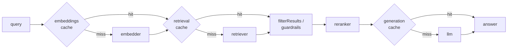

# Caching

`createRagPipeline({ cache })` can cache three things, so a repeated question skips the model calls:

| Layer        | What is cached              | Keyed by                                                                                    | Default time to live |
| ------------ | --------------------------- | ------------------------------------------------------------------------------------------- | -------------------- |
| `embeddings` | The query's vector          | The embedder's identity and the query text                                                  | 30 days              |
| `retrieval`  | The retriever's raw results | The retriever's current state, the query vector and text, and `topK`                        | 1 hour               |
| `generation` | The answer                  | The LLM's identity, the query, the exact documents it was given, and the generation options | 24 hours             |

:::info[Coming in 2.6.0]

Caching, `MemoryCache` and `RedisCache` are in the next release.

:::



## Turn it on

`cache: true` caches all three layers in memory:

```javascript
import { createRagPipeline } from "@devilsdev/rag-pipeline-utils";
import {
  createTestPipeline,
  EchoLLM,
} from "@devilsdev/rag-pipeline-utils/testing";

const { embedder, retriever } = await createTestPipeline();
const llm = new EchoLLM();
const pipeline = createRagPipeline({ embedder, retriever, llm, cache: true });

await pipeline.run({ query: "How many vacation days do I get?" });
const again = await pipeline.run({ query: "How many vacation days do I get?" });

console.log(again.cache.generation); // "hit"
console.log(llm.calls.length); // 1
```

Each result carries `cache: { embeddings, retrieval, generation }`, with `"hit"`, `"miss"` or `"skip"` per layer, and `pipeline.cacheStats()` returns the hits, misses and skips per layer.

Choose layers, stores and lifetimes separately:

```javascript no-run
import {
  createRagPipeline,
  MemoryCache,
  RedisCache,
} from "@devilsdev/rag-pipeline-utils";
import { createClient } from "redis"; // or ioredis

const redis = await createClient({ url: process.env.REDIS_URL }).connect();

const pipeline = createRagPipeline({
  embedder,
  retriever,
  llm,
  cache: {
    embeddings: new RedisCache({ client: redis, prefix: "rag:" }),
    retrieval: new MemoryCache({ maxEntries: 1000 }),
    generation: false,
    ttlSeconds: { embeddings: 7 * 24 * 3600, retrieval: 600 },
  },
});
```

`MemoryCache({ maxEntries, ttlSeconds })` evicts the least recently used entry. `RedisCache({ client, prefix, ttlSeconds })` takes a connected client from `redis` (version 4 or later) or `ioredis`; neither is a dependency of this package. Any object with `get(key)` and `set(key, value, { ttlSeconds })` works as a store.

## When a cached result is not used

Caching never returns results for a different model, index or configuration:

- **Your index changes.** `MemoryRetriever` and `FileVectorStore` report their state, so storing, removing or clearing documents means the next query misses. A `FileVectorStore` read by several processes shares cached results while the file is unchanged.
- **Your embedder changes.** Retrieval is keyed by the query vector, not just the text, and a retrained `LocalEmbedder` has a new identity.
- **The model or its settings change.** Built-in connectors' identities include the model, endpoint, temperature, token limit and system prompt.
- **The temperature is above 0.** The answer would vary, so `generation` is skipped (`"skip"`). The built-in connectors default to 0.7: set `temperature: 0`, on the connector or per run, to cache answers. AI SDK models need `settings: { temperature: 0 }`.
- **A run fails, is aborted or times out.** Nothing from it is stored. A streamed answer is stored only when the stream finished.
- **A component has no identity.** A layer caches only when its component has a `getCacheKey(role)` method or a `cacheKey` string. All built-ins, the AI SDK adapter and the `/testing` helpers have one. A custom component without one is not cached, and a warning (`RAG_CACHE_NO_KEY_*`) says so once:

```javascript
const myLlm = {
  cacheKey: "my-llm|model-v2|temperature=0", // change it when the model changes
  async generate(query, docs) {
    return docs[0]?.content ?? "No information found.";
  },
};
```

A store that fails (Redis down, say) does not fail the run. The pipeline warns once and carries on without the cache.

## Caching and access control

Retrieval is cached **before** `filterResults` and the reranker. Guardrail ACL filtering (`GuardrailsPipeline` with `retrieval: { enforceACL: true }`) therefore runs on every request, against that request's `userPermissions`. The answer cache is keyed by the exact documents the LLM received, so users with different permissions never share an answer. The test suite checks this with two users of a shared cache.

## What it saves

Measured with simulated latencies (80 ms embedding call, 600 ms LLM call): the first run took 704 ms and repeats took under 1 ms, because a fully cached repeat makes no model calls.
