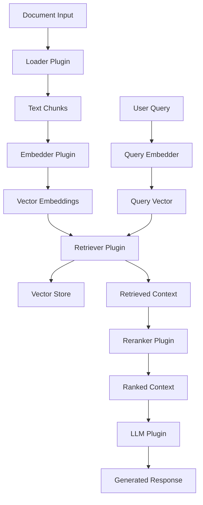

# Introduction

Welcome to **@devilsdev/rag-pipeline-utils**, a modular Node.js toolkit for building Retrieval-Augmented Generation (RAG) systems. It provides composable pipelines with pluggable components, streaming, cancellation, citations, guardrails and built-in evaluation.

---

## What is RAG?

Retrieval-Augmented Generation (RAG) is a powerful AI architecture that combines information retrieval with large language models to enhance text generation with factual, contextual grounding. Unlike traditional LLMs that rely solely on training data, RAG systems dynamically retrieve relevant information to inform responses.

### The RAG Process

1. **Document Ingestion**: Load and chunk documents into manageable pieces
2. **Embedding Generation**: Convert text chunks into vector representations
3. **Vector Storage**: Store embeddings in a searchable vector database
4. **Query Processing**: Convert user queries into vector representations
5. **Retrieval**: Find the most relevant document chunks using similarity search
6. **Context Augmentation**: Combine retrieved context with the original query
7. **Generation**: Use an LLM to generate responses informed by the retrieved context

### Real-World Applications

- **Knowledge Base Q&A**: Answer questions from internal documentation
- **Customer Support**: Provide accurate responses from support articles
- **Research Assistance**: Synthesize information from academic papers
- **Code Documentation**: Generate explanations from codebases
- **Legal Document Analysis**: Extract insights from legal texts

---

## Why Choose @devilsdev/rag-pipeline-utils?

### **Composable Pipeline**

- **`createRagPipeline`**: embed, retrieve, filter, rerank and generate with any components that implement the stage contracts
- **Cancellation**: `options.signal` (an `AbortSignal`) and `options.timeout` cancel work in every built-in connector and reranker
- **Streaming**: token streams, with citations and evaluation delivered in the final chunk
- **Provider connectors**: OpenAI, Anthropic, Cohere and Ollama, plus an offline TF-IDF `LocalEmbedder`, `MemoryRetriever` and the persistent `FileVectorStore`

### **Quality and Safety**

- **Evaluation**: faithfulness, answer relevance, context precision, context recall (with a reference answer) and groundedness via `PipelineEvaluator`
- **Citations**: per-sentence source attribution and hallucination detection, including a numeric-consistency check
- **Guardrails**: pre-retrieval injection detection, retrieval filtering (ACL, relevance, freshness, optional injection scan) and post-generation checks
- **Reranking**: scoring, embedding, LLM and cascade rerankers

### **Developer Experience**

- **CLI**: `init`, `ingest`, `query`, `run`, `serve`, `validate`, `doctor`, `hub` and `ai` against a local file-backed index
- **Configuration Schema**: validated `.ragrc.json`
- **Hot Reload**: `HotReloadManager` and `DevServer` for local development
- **TypeScript**: declarations for every runtime export

### **Observability**

- **Structured logging** (pino), in-process metrics and `ExecutionTracer` run traces
- **Cost tracking**: `CostCalculator`, `CostTracker`, `TokenBudget` with pricing provenance (`PRICING_METADATA`)
- **Audit logging**: `AuditLogger` with optional field encryption and HMAC integrity checks
- **Dashboards**: self-contained HTML reports from `MetricsAggregator` and `DashboardGenerator`

### **Experimental Modules**

Multi-modal processing, federated learning, adaptive retrieval, model training, SSO, multi-tenancy, data governance, plugin sandboxing and plugin certification classes are simulated or incomplete. They are exported from `@devilsdev/rag-pipeline-utils/experimental`. See [Experimental modules](./Experimental.md).

---

## Core Architecture

The toolkit follows a modular, plugin-based architecture where each component has a specific responsibility:



### Core Components

Each stage is a plugin that implements one contract method: loader `load()`, embedder `embed()` (optionally `embedQuery()`), retriever `store()` and `retrieve()`, llm `generate()` (optionally `generateStream()`), reranker `rerank()`. Built-in implementations:

| Stage     | Library classes                                                              | `.ragrc.json` names (CLI)             |
| --------- | ---------------------------------------------------------------------------- | ------------------------------------- |
| Loader    | (bring your own)                                                             | `auto` (.md, .html, .csv, .txt)       |
| Embedder  | `LocalEmbedder`, `OpenAIConnector`, `OllamaConnector`, `CohereConnector`     | `local`, `openai`, `ollama`, `cohere` |
| Retriever | `MemoryRetriever`, `FileVectorStore`, `HybridRetriever`, `GraphRetriever`    | `memory`, `file-store`                |
| LLM       | `OpenAIConnector`, `AnthropicConnector`, `OllamaConnector`                   | `openai`, `anthropic`, `ollama`       |
| Reranker  | `ScoringReranker`, `EmbeddingReranker`, `CascadeReranker`, `CohereConnector` | `scoring`                             |

Hosted vector databases (Pinecone, Chroma, Weaviate, Qdrant and others) are not built in; connect them with a custom retriever plugin (see [Plugins](./Plugins.md)).

---

## Quick Start Example

This example runs fully offline with the TF-IDF `LocalEmbedder`. Swap in `OpenAIConnector`, `AnthropicConnector` or `OllamaConnector` for real embeddings and generation.

```javascript
const {
  createRagPipeline,
  LocalEmbedder,
  MemoryRetriever,
} = require("@devilsdev/rag-pipeline-utils");

const docs = [
  {
    id: "1",
    content: "Plugins implement one stage method, such as generate().",
  },
  { id: "2", content: "Register plugins on pluginRegistry with metadata." },
];

// Index the documents
const embedder = new LocalEmbedder();
embedder.train(docs);
const retriever = new MemoryRetriever();
await retriever.store(
  docs.map((d) => ({ ...d, vector: embedder.embed(d.content) })),
);

// Pass the embedder so each query is embedded before retrieval
const pipeline = createRagPipeline({ embedder, retriever /*, llm */ });

const response = await pipeline.run({
  query: "How do I implement custom plugins?",
});

console.log("Success:", response.success);
console.log("Results:", response.results.length);
console.log("Answer:", response.answer); // null without an llm
```

### CLI Usage

```bash
# Install globally
npm install -g @devilsdev/rag-pipeline-utils

# Write .ragrc.json in the current directory (OpenAI embeddings and LLM)
rag-pipeline init --no-interactive --template openai

# Ingest documents (.md, .html, .csv, .txt)
rag-pipeline ingest ./docs

# Query your knowledge base
rag-pipeline query "What is the plugin architecture?"

# Serve the pipeline as a local HTTP API (GET /health, POST /query)
rag-pipeline serve --port 3000
```

Evaluation and dashboards are library APIs (`PipelineEvaluator`,
`DashboardGenerator`) rather than CLI commands; see
[Evaluation](./Evaluation.md). The full command list is in the
[CLI Reference](./CLI.md).

---

## Project Status & Roadmap

### **Supported Features**

- **Core pipeline**: `createRagPipeline` with cancellation, timeouts and streaming
- **Provider connectors**: OpenAI, Anthropic, Cohere and Ollama, plus `LocalEmbedder`
- **Storage**: `MemoryRetriever` and the JSON-file `FileVectorStore`
- **Citation & Grounding**: source attribution, hallucination detection, numeric consistency
- **Evaluation**: `PipelineEvaluator` and the `compute*` metric functions
- **3-Layer Guardrails**: pre-retrieval, retrieval and post-generation guards via `GuardrailsPipeline`
- **Hybrid Retrieval (BM25 + RRF)**: combined sparse and dense retrieval with reciprocal rank fusion
- **Agentic RAG**: `QueryPlanner`, `IterativeRetriever`, `SelfCritiqueChecker`, `AgenticPipeline`
- **GraphRAG**: knowledge graph construction and graph-based retrieval
- **Streaming Embeddings**: `StreamingEmbedder` and `createEmbeddingStream` for large corpora
- **Cost Management**: token and cost tracking with documented pricing provenance
- **Dashboards**: HTML and text reports from collected metrics
- **MCP Integration**: `MCPServer` and `MCPToolBuilder`
- **Developer Tools**: CLI with a local index, `doctor` diagnostics, plugin install and certification checks, and a local HTTP dev server

### **Experimental**

SSO, multi-tenancy, data governance, model training, federated learning, multi-modal processing, adaptive retrieval, plugin sandboxing and `PluginCertification` are simulated or incomplete and live in the `/experimental` entry. Do not rely on them for authentication, tenant isolation, compliance or plugin isolation. See [Experimental modules](./Experimental.md).

---

## Community & Support

- **GitHub Repository**: [DevilsDev/rag-pipeline-utils](https://github.com/DevilsDev/rag-pipeline-utils)
- **Documentation**: [https://devilsdev.github.io/rag-pipeline-utils](https://devilsdev.github.io/rag-pipeline-utils)
- **NPM Package**: [@devilsdev/rag-pipeline-utils](https://www.npmjs.com/package/@devilsdev/rag-pipeline-utils)
- **Issues & Bug Reports**: [GitHub Issues](https://github.com/DevilsDev/rag-pipeline-utils/issues)
- **Discussions**: [GitHub Discussions](https://github.com/DevilsDev/rag-pipeline-utils/discussions)

### Contributing

We welcome contributions! See our [Contributing Guide](https://github.com/DevilsDev/rag-pipeline-utils/blob/main/CONTRIBUTING.md) for details on:

- Setting up the development environment
- Running tests and linting
- Submitting pull requests
- Creating new plugins
- Writing documentation

---

_Ready to build powerful RAG applications? Continue to the [Architecture](./Architecture.md) guide to understand the system design, or jump to [Usage](./Usage.md) for hands-on examples._

- Compatible with Node.js `>=22` (2.x runs on Node.js 18 and later)
- Published to npm as `@devilsdev/rag-pipeline-utils`

---

Let’s get started!

Next → [Usage](./Usage.md)
